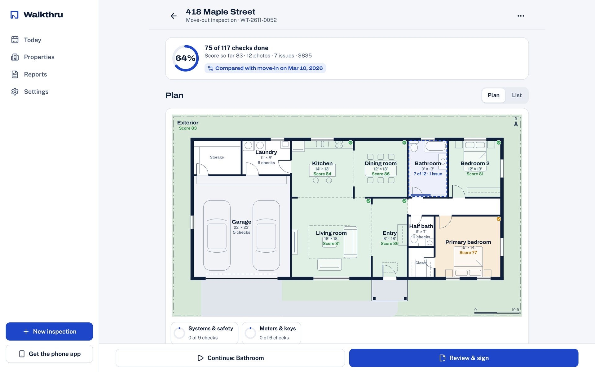
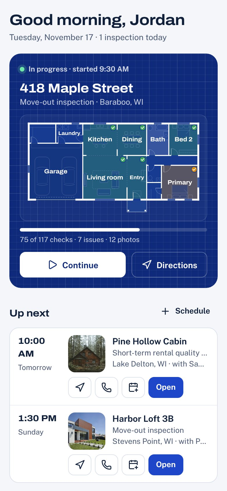
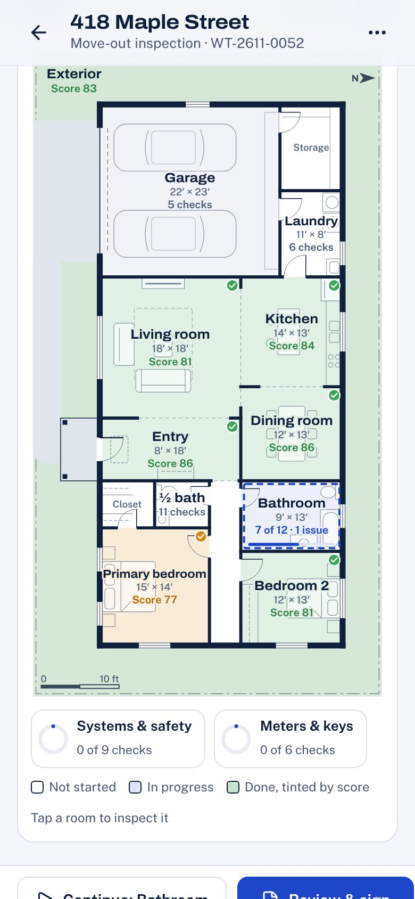
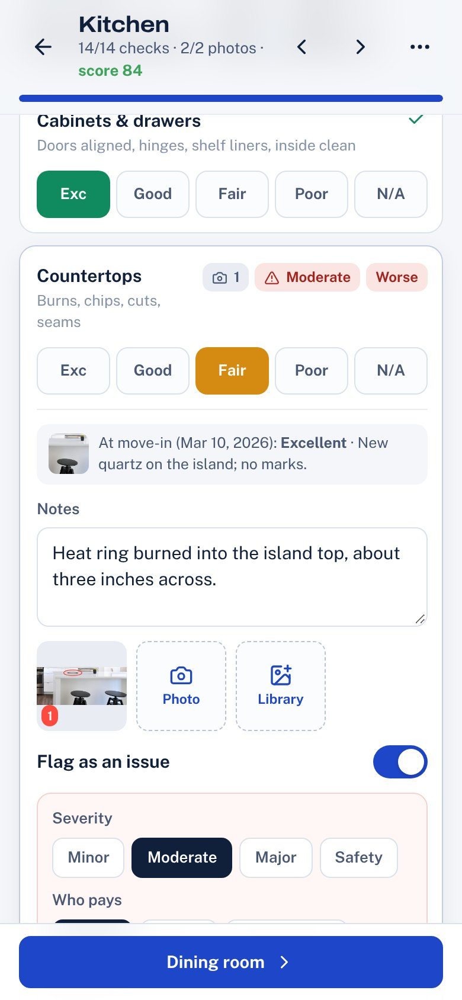
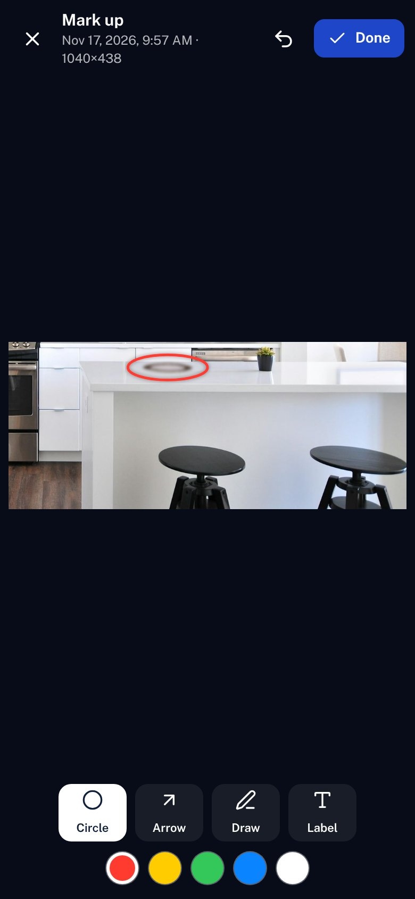
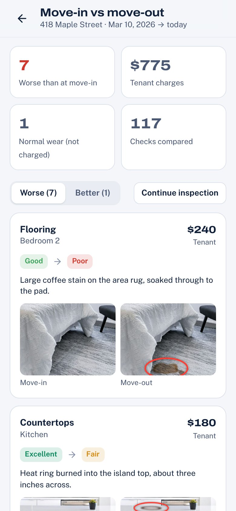
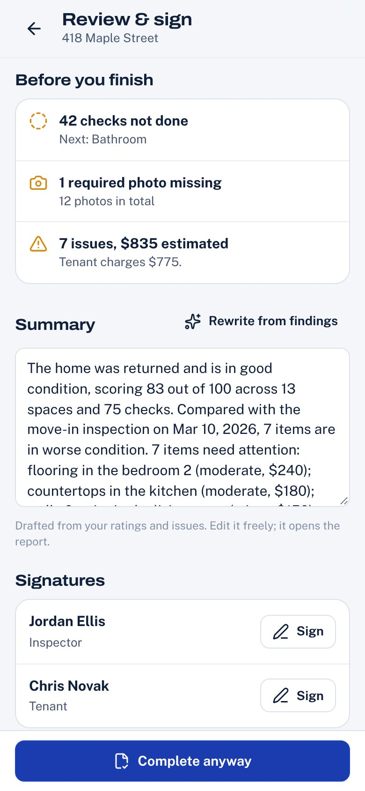
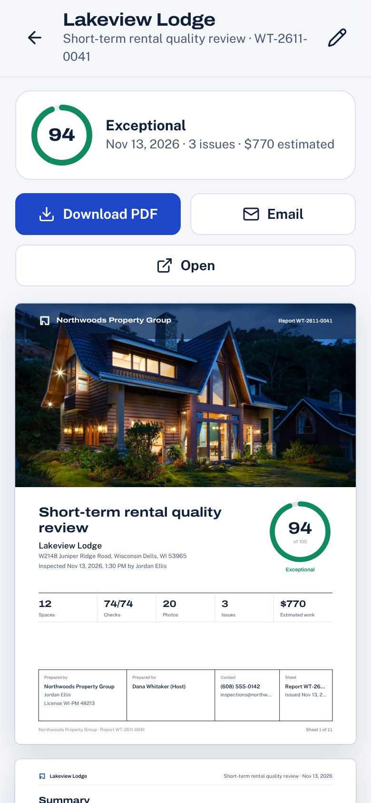
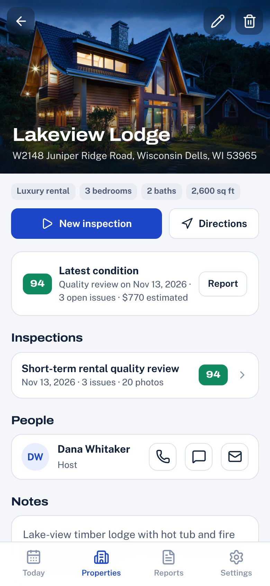

# Walkthru: property inspection app (Android, iPhone and web)

Walkthru runs a property inspection from the front door to the signed report: **room-by-room checklists, photos with markup, a live floor plan of the home, move-in vs move-out comparison and a branded PDF report**. It's built for property managers, short-term rental hosts, home inspectors and anyone who needs proof of a home's condition on a given day.

**Live demo:** [neomaverick1.github.io/walkthru](https://neomaverick1.github.io/walkthru/). It opens on a Tuesday morning partway through a move-out at 418 Maple Street, with four other homes, finished reports and real photos. Everything you change stays in your browser, and Settings → Reload the demo starts it fresh.

**Phone apps:** [download Walkthru.apk](https://neomaverick1.github.io/walkthru/Walkthru.apk) for Android. It uses the phone's camera, works offline and shares reports through the phone's share sheet. On iPhone, open the demo in Safari, tap Share, then **Add to Home Screen**. The Android and iOS projects are [Capacitor](https://capacitorjs.com) apps in [`android/`](android) and [`ios/`](ios).



<p>
  
  
  
  
</p>
<p>
  
  
  
  
</p>

**Sample report:** [docs/sample-report.pdf](docs/sample-report.pdf), the PDF from the demo's short-term rental review of Lakeview Lodge.

Every push to `main` type-checks, lints and tests the code, rebuilds and redeploys the live demo, builds the Android APK, the Google Play bundle and the iOS app, and publishes a release ([`.github/workflows/build.yml`](.github/workflows/build.yml)).

## Features

| Area                    | What it does                                                                                                                                                                                                                                                                                               |
| ----------------------- | ---------------------------------------------------------------------------------------------------------------------------------------------------------------------------------------------------------------------------------------------------------------------------------------------------------- |
| **Inspection types**    | Move-in, move-out, short-term rental quality review, pre-listing walkthrough and routine inspection. Each builds its own list of spaces and checks from the home's bedrooms, baths, garage and laundry, and asks for the photos that type needs.                                                            |
| **Live floor plan**     | The home is drawn as an architect's plan from its list of rooms: garage and mudroom, open kitchen, dining and living, an entry with a porch, bedrooms and baths off a hall, a primary suite with its own bath and walk-in closet, a deck. Rooms tint as they're inspected and you tap a room to open it. On a phone the plan turns sideways so every room is big enough to read and tap. |
| **Checklists**          | Excellent, good, fair, poor or not applicable for each item, with hints for what to look at. Meter readings, key counts and a built-in Wi-Fi speed test for rentals.                                                                                                                                         |
| **Photos**              | Required shots for each room, plus photos on any item from the camera or the library. Each photo is checked for blur and light the moment it's taken. Circles, arrows, freehand and labels in five colors, drawn over the photo and kept in the report.                                                     |
| **Issues**              | Flag any item as an issue with a severity (minor, moderate, major, safety), who pays (tenant, owner or normal wear), what to do (clean, repair, replace, monitor) and an estimate. Totals by who pays.                                                                                                     |
| **Move-in vs move-out** | A move-out is compared with the move-in item by item: what got worse, what got better, the photos side by side and the tenant's charges, with normal wear kept separate.                                                                                                                                  |
| **Review and sign**     | Checks that nothing was missed, drafts a plain-English summary from the ratings and issues, and collects signatures from the inspector and the tenant or host on screen.                                                                                                                                  |
| **PDF report**          | A branded report laid out like a set of drawings: a cover with the home's photo and score, findings with costs, changes since move-in with photo pairs, condition by space, every room with its photos and notes, signatures and sheet numbers. Download, email or share it.                         |
| **Schedule**            | Today's inspections and what's next, with directions, a call button and Add to calendar.                                                                                                                                                                                                                   |
| **Properties**          | Homes with cover photos, details, contacts and notes, and every inspection of each one.                                                                                                                                                                                                                    |
| **Branding**            | Company name, logo, license number, accent color, currency and the disclaimer at the end of each report.                                                                                                                                                                                                  |
| **Offline**             | Everything, photos included, is stored on the device, so a whole inspection works with no signal. A backup is one file you can move to another phone.                                                                                                                                                     |

## How the floor plan is drawn

[`src/lib/floorplan.ts`](src/lib/floorplan.ts) turns any list of rooms into a single-storey plan in feet, and [`src/components/PlanView.tsx`](src/components/PlanView.tsx) draws it as SVG.

- **Zones:** the garage wing (with the laundry as a mudroom between the garage and the kitchen), then the open-plan kitchen, dining, living room and entry, then bedrooms and baths on both sides of a hall, with the primary suite across the end of the hall.
- **Sizes:** every kind of room has a normal range (a secondary bedroom is 10 to 15 feet wide, a half bath 5 to 7.5). The generator tries every way of splitting the rooms across the hall, picks the one that keeps both sides closest to their natural sizes, then stretches or squeezes each room within its range so both sides line up. Where a real house would have one, it adds a closet: a half bath gives the bedroom next to it a walk-in closet.
- **Walls:** the outside walls are traced around whatever shape the rooms make, inside walls are merged so each is drawn once, and every door, window and opening is cut out of them. Doors swing into the room they belong to.
- **Furniture:** beds against the far wall with nightstands, toilets, tubs and vanities, kitchen counters with the sink under the window, an island with stools, a dining table, a sofa facing the TV, washer and dryer, cars in the garage, a hot tub and a fire pit when the listing has them. Each room's furniture is drawn in the room's own frame, so the same drawing works on any side of the hall.
- **Tests:** [`floorplan.test.ts`](src/lib/floorplan.test.ts) lays out the demo homes and 300 random mixes of rooms and checks that every room is placed once, nothing overlaps, every space has a way in and the primary bath opens off the primary bedroom.

## Built with

- **React 19 + TypeScript**, built with **Vite**. No UI kit: the components, the floor plan and the photo markup are written for this app.
- **Capacitor 8** for the Android and iOS apps, with the camera, file system and share sheet plugins.
- **pdf-lib** with embedded fonts for the report, and **pdf.js** for the preview. Both load only when a report is opened.
- **IndexedDB** (through `idb`) for homes, inspections and photos, saved as you go.
- **oxlint** and **Vitest**; GitHub Actions for the checks, the APK, the Play bundle, the iOS build, the release and the live demo.

## Project layout

| Path                            | What's in it                                                                           |
| ------------------------------- | -------------------------------------------------------------------------------------- |
| `src/screens/`                  | Today, Properties, a property, an inspection, a room, review and sign, compare, report |
| `src/components/PlanView.tsx`   | The floor plan drawing                                                                 |
| `src/components/Photo.tsx`      | Photos with their markup, the photo viewer and the markup editor                       |
| `src/lib/floorplan.ts`          | The floor plan generator                                                               |
| `src/lib/templates.ts`          | Inspection types, the spaces and checks for each, required photos                      |
| `src/lib/score.ts`              | Progress, scores and issue totals                                                      |
| `src/lib/compare.ts`            | Move-in vs move-out                                                                    |
| `src/lib/report.ts`             | The PDF report                                                                         |
| `src/lib/photos.ts`             | Taking photos, the blur and light check, drawing marks into the image                 |
| `src/lib/store.ts`              | State and storage on the device                                                        |
| `src/lib/demo.ts`               | The demo homes and inspections                                                         |
| `android/`, `ios/`              | The Capacitor apps                                                                     |

## Run it

```bash
npm install
npm run dev          # the web app at http://localhost:5173
npm test             # floor plan and scoring tests
npm run build        # production build in dist/
npm run android      # build and copy into android/, then open it in Android Studio
npm run ios          # build and copy into ios/, then open ios/App in Xcode
```

The demo loads on first launch. To start with an empty app, use Settings → Erase everything.
